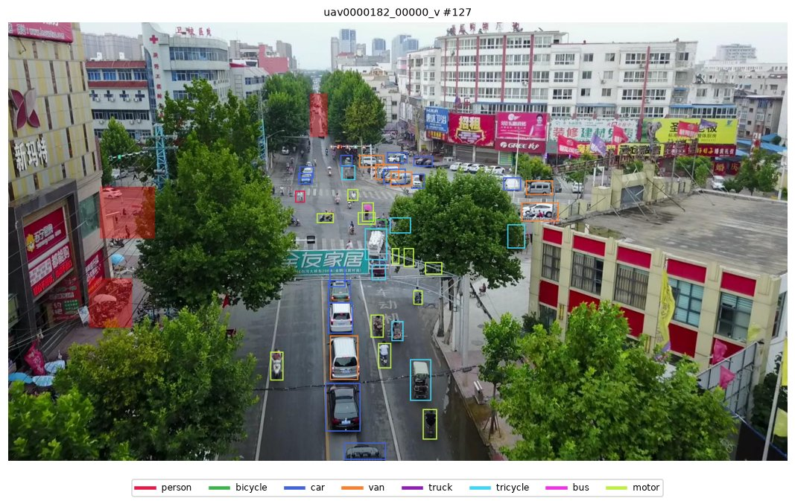
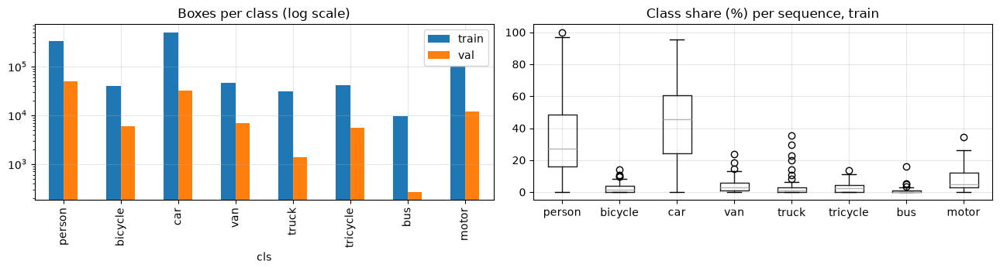

## Summary

The task is detecting 8 object classes in video frames, scored by COCO mAP. Most objects are small, and scenes are dense. I trained four detector families under the same protocol: a sequence-level train/val split and the same budget for each. The query-based RT-DETR beat the CNN detectors (YOLO11, Faster R-CNN, RetinaNet) at every object size, so it became the base of the final pipeline. Three changes gave the largest gains: a longer, higher-resolution RT-DETR run, tile-based training for small objects, and a WBF ensemble of models whose errors differ. The final submission is a WBF ensemble of two RT-DETR models at different input sizes and YOLO11s, retrained on train + val.

## 1. Data understanding and preprocessing

Source: [01_data_analysis.ipynb](notebooks/01_data_analysis.ipynb)

### 1.1 Dataset and split

The dataset contains drone videos with box labels for 8 classes (person, bicycle, car, van, truck, tricycle, bus, motor) and ignore regions. It is split by video, so no video appears in two splits.

| split | videos | frames | boxes |
|---|---|---|---|
| train | 56 | 24,201 | 1,105,516 |
| val | 7 | 2,846 | 114,132 |
| test | 48 | 3,811 | hidden |

All models are trained on train, and val is used only for validation and metrics. Test is unlabeled and scored on Kaggle; only the final models were trained on train + val. The validation set is not very representative: it has only 7 videos and a different class mix (1.4), so per-class metrics on val are noisy.

### 1.2 Ignore regions

Ignore regions are areas where objects are not labeled. In training they are not used as targets; in validation, a detection inside them does not count as a mistake. 75% of train frames have at least one ignore region, but only 1.1% of boxes lie inside one, so objects there are mostly not annotated at all.

### 1.3 Label quality

Some frames have unlabeled objects. In the val frame below, not all cars in the parking lot (top right) are labeled. There are also incorrect labels, for example tricycle and motor boxes on the tree canopy.



One train frame has many incorrect labels: in the bottom right corner of #322 there are many boxes with no object inside, while its neighbours in the video do not have them (180 boxes against 100 in #321 and 88 in #323).


### 1.4 Class distribution

The dataset is unbalanced: car (46% of train), person (30%) and motor (9%) dominate, the other classes have 3–4% each, and bus only 0.9%; it is absent from 32 of the 56 train videos. Val has a different mix: more person (44%), less car (28%) and only 264 buses (0.2%).



### 1.5 Image resolution and object sizes

Resolutions range from 680x382 to 3840x2160. Most train images are medium-sized (53% are 1904x1071), val has more high-resolution ones (34% are 3840x2160), and test has none above 1920x1080 but 16% low-resolution ones (680x382, 960x540) that train and val lack.

Most objects are small (54%) or medium (43%), measured as $\sqrt{w \cdot h}$ at a 1280 px long side with the COCO buckets (small < 32 px, large > 96 px). Person, bicycle and motor are mostly small, car, van, truck and tricycle mostly medium, and bus medium and large. The median object size per video varies from 18 to 58 px.

| % of boxes | small | medium | large |
|---|---|---|---|
| **all classes** | **54** | **43** | **3** |
| person | 73 | 27 | 0 |
| bicycle | 70 | 30 | 0 |
| car | 42 | 53 | 4 |
| van | 44 | 51 | 5 |
| truck | 26 | 59 | 14 |
| tricycle | 36 | 60 | 4 |
| bus | 13 | 55 | 32 |
| motor | 70 | 29 | 0 |

To choose the input size, I checked the share of objects below 16 px after resizing, since these are very hard to detect. I chose a 1280 px long side (9.8%, against 24% at 960 px) as a middle ground between training/inference time and performance.

| long side, px | 640 | 960 | **1280** | 1920 |
|---|---|---|---|---|
| % of boxes < 16 px | 54.2 | 24.0 | **9.8** | 1.7 |

### 1.6 Anchor sizes and shapes

Anchor-based models (Faster R-CNN, RetinaNet) predict boxes relative to a few predefined anchor sizes and shapes. To find good sizes, I ran k-means (k = 3, 5, 9) on the box widths and heights at 1280 px:

| k | mean best IoU | anchors (w x h, px) |
|---|---|---|
| 3 | 0.60 | 15x21, 32x32, 75x58 |
| 5 | 0.66 | 13x18, 19x34, 32x23, 44x41, 92x66 |
| 9 | 0.73 | 11x15, 13x28, 22x19, 20x39, 40x22, 30x31, 39x53, 63x34, 100x72 |

These shapes only show the useful size range, about 13–100 px, far below the 32–512 px default. torchvision takes one anchor size per feature-pyramid level combined with fixed aspect ratios, so the training sizes come from a 1D k-means (k = 5, log scale) of $\sqrt{w \cdot h}$: 13/21/31/48/87 px for Faster R-CNN, and 13/26/52/104/208 px for RetinaNet (the smallest size, doubled per level like the stride). The aspect ratios stay at the default {0.5, 1, 2}, since they cover the box ratios h/w:

| percentile | 10th | 50th | 90th |
|---|---|---|---|
| h / w | 0.47 | 1.06 | 2.25 |

### 1.7 Scene density

Most scenes are dense. The mean number of objects per frame varies from 5 to 143 across videos, and the densest frame has 180, so a model must output at least 300 detections (or DETR queries) per image.

| | train | val |
|---|---|---|
| mean objects per frame | 45.7 | 40.1 |
| median | 43 | 37 |
| frames with > 100 objects | 7.6% | 6.4% |

### 1.8 Temporal redundancy

The frame rate is high, so consecutive frames are near-duplicates: they add little to performance but slow down training. I measured the median IoU of the same object k frames apart:

| frame gap k | 1 | 2 | **3** | 5 | 10 |
|---|---|---|---|---|---|
| median IoU of the same object | 0.90 | 0.81 | **0.73** | 0.60 | 0.36 |
| % of objects with IoU > 0.5 | 96 | 86 | **75** | 59 | 39 |

I keep every 3rd frame (8,090 train / 951 val frames), a balance between training time and losing information.

### 1.9 Preprocessing

| step | setting |
|---|---|
| frames | every 3rd frame of each video |
| resize | long side 1280 px, aspect ratio kept |
| normalisation | pixels scaled to [0, 1]; mean/std are applied inside each model |
| training augmentation | horizontal flip (p = 0.5), scale jitter 0.75–1.25, colour jitter 0.2 (YOLO and RT-DETR: Ultralytics' built-in augmentation) |
| val / test | resize only |
| targets | 8 classes; ignore regions are not targets and stay in the evaluation ground truth as `iscrowd` |
| reproducibility | seed 42 for python, numpy, torch and the data loaders |

### 1.10 Summary

- **Small objects:** 54% of boxes are under 32 px → 1280 px input, anchors from 13 px, high-resolution feature levels.
- **Dense scenes:** up to 180 objects per frame → at least 300 detections / queries per image.
- **Class imbalance:** car and person are 76% of boxes, bus under 1% → rare-class AP is noisy.
- **Noisy labels:** unlabeled objects and some false boxes cap the achievable mAP.
- **Near-duplicate frames:** every 3rd frame is kept, 3x faster training.
- **Val differs from test:** 4K frames only in val, low-resolution frames only in test → addressed in the final pipeline (section 4).

## 2. Validation protocol

- **Split:** the provided video-level split (56 train / 7 val videos), every 3rd frame, the same for all models.
- **No cross-validation:** K-fold CV would multiply training time by about K, which neither my local GPU (RTX 2050, 4 GB) nor Kaggle's 30 h weekly GPU limit allows. All models use the same split and seed (42), so results are comparable, but differences of a few thousandths of mAP are within noise.
- **Metrics:** COCO mAP@[.5:.95], AP50, AP_small / medium / large and AR (pycocotools), up to 300 detections per image; ignore regions stay in the ground truth as `iscrowd`.
- **Budget:** each required detector is trained from COCO-pretrained weights for about 1–1.5 h on a Kaggle T4, and its experiments keep the same budget. The input is 1280 px, except RT-DETR, which trains at 960 px because a 1280 px input costs 1.6x more per image.

## 3. Detector families

### 3.1 Two-stage: Faster R-CNN

Source: [02_two_stage.ipynb](notebooks/02_two_stage.ipynb)

Faster R-CNN with ResNet50 FPN backbone with pretrained weights on the COCO dataset.

Baseline model with default hyperparameters got next results:

[add table with the results]

For the first experiment i descided to tune hyperparameters:

- RPN proposals - number of the regions which possibly contain object the Region Proposal Network proposes. (300, 1000, 2000)
- NMS IoU - the Non-Maximum suppression is the mechanism which keeps model from giving a few boxes for the same object. It is applied after the second stage and if boxes for the two predictions of the same class have IoU more than threshold only the more confident is left. (0.4, 0.5, 0.6)

The frid was almost flat, all changes of the mAP was within 0.005, which can possibly be just noice. The best configuration was 1000 proposals and NMS 0.6.

[add table with the results keep only mAP, no time and small mAP]

For this change no retraining was needed since weights keeps unchanged.

For the second experiment i descided to tune anchor box sizes:

[put here sizes and spect ratios, add link to the section 1.6]

To check how good this boxes fir I matched each box in the frame with all this and the default sizes (32-512) for reference and check find IoU between GT box and each new box. I kept only the best fit IoU. The IoU increased for the objects with size <96px (97% of the objects) but for larger it decreased since they bigger than the proposed anchors.

[add table form the 6 - anchor sizes]

Despite the IoU fit better the results was much worse - mAP decreased by 0.27 compared with the baseline. 

Possible reason may be that the number of epochs was to low for the network to addapt its weights to new anchor boxes since the pretrained backbone used default sizes.

The final model from this stage is model with default anchors and 1000 proposals, 0.6 NMS IoU threshold.

[add full comparison table]

[add train epoch plot]

What each stage contributes:

- RPN (first stage) - class-agnostic detection of the objects. It proposes a lot of candidate boxes oand only the best are left. Each candidate box here has an anchor size and rough correction to it. Its recall is an upper bound for the whole model since the object without the proposal cannot be detected.
- RoI head (second stage): pools features for each proposals, classifies into 8 classes or background, refines the box second time, removes dublicates with NMS.


Failure cases:

- For the model it is hard to classify small bicicles, it perplexed them in 45% of the casses with motors, possibly because the motors had much higher presence in the dataset than bicycle
- Almost all busses are classified incorrectly - 71% of them classified as car. It is direct consequence of unbalansness and very low presens of the buses in the dataset

[add confussion matrix]

- First failure case frame is (the frame mentioned in the 1.3) had labels not for all cars on the parking and model correctly classified them but the score was lowed because GT didnt have them labeld. Also some small objects are misclassified or missed
- On the second frame there are a lot of biciclesclassified as motors
- Third frame has the same issues as the first and addtionaly it classified trafic light as the van, some other objects are missclassified or missed too.

[3 frames from the notebook with conparison of GT and predictions]

### 3.2 One-stage anchor-based: RetinaNet

> - Experiments: anchor sizes grounded in the size statistics from section 1 (`retina_anchors`), IoU thresholds of anchor assignment (`retina_iou`), tuned (`retina_final`).
> - Does removing the proposal stage cause issues: foreground/background imbalance, handled by focal loss; what you saw in practice.
> - Comparison initial vs. tuned vs. tuned Faster R-CNN.

### 3.3 One-stage anchor-free: YOLO11

> - How locations are assigned without anchors (task-aligned assigner), effect on small/dense objects.
> - Experiments: P2 high-resolution head (`yolo_p2`), NWD box loss (`yolo_loss`), tuned test-time resolution × NMS IoU (`yolo_final`). State the search range and the selected values.
> - Comparison with tuned anchor-based models broken down by object size (AP_s/AP_m/AP_l). First public LB score.

### 3.4 Query-based: RT-DETR

> - Experiments: separate backbone/transformer LR (`rtdetr_lr`), denoising queries count (`rtdetr_nd200/400`), tuned (`rtdetr_final`).
> - Bipartite matching removes NMS — 2 sentences, and how it changes training (slower convergence, one-to-one targets).
> - Plot: val mAP over epochs vs. a CNN detector under the same budget. State whether it converged.
> - Small objects and dense scenes vs. YOLO.

### 3.5 Comparison of all models

> - One summary table: every tuned model (+ baselines in gray or separate rows): mAP, AP50, AP_s, AP_m, AP_l, FPS, public LB.
> - 3–4 sentences: which family wins on this data and why (small objects, density), the speed/accuracy trade-off, and which models go into the final pipeline.

## 4. Final pipeline

> **Contains:** must clearly separate "data/inference changes" from "model changes" (graded separately). Keep the same validation as above.

### 4.1 Data and inference strategy

> Source: `notebooks/final_pipeline/01_data_tests.ipynb`.
> - Table: reference vs. masked ignore regions (`s1_ignore`), low-resolution simulation (`s1_lowres`), less mosaic (`s1_mosaic`), tile-based training (`s1_tile`) — val mAP and public LB.
> - Which changes helped, which did not, and a likely reason for each.

### 4.2 Model changes

> Source: `notebooks/final_pipeline/02_long_runs.ipynb`.
> - Long runs at 960 and 1280 (`s2_960`, `s2_1280`): gain from more epochs / higher resolution compared to the budget-limited runs in section 3.
> - Effect of model change kept separate from the data change in 4.1.

### 4.3 Ensembles and final selection

> Source: `notebooks/final_pipeline/03_final_models.ipynb`.
> - WBF ensemble options (1280 + 960 + YOLO11s + tile) — table with val mAP and public LB.
> - Retraining on train + val: why it is allowed now (hyperparameters already fixed) and what changed.
> - The two submissions selected for the private LB and why (internal val, not only public LB).

### 4.4 Unsuccessful attempts

> Short list of what did not work, with the numbers: e.g. NWD loss, low-resolution simulation, specific ensemble members, any bugs found (WBF fix). One line each: what, result, likely why.

## 5. Conclusions

> 3–5 bullets: main lessons (resolution and small objects matter most, which family fits VisDrone best, what data/inference strategy gave the largest gain, what you would try next with more compute — e.g. temporal post-processing, SAHI).

## 6. Final model and run instructions

> **Contains:** name the exact final model/ensemble and the submission file. Then how to reproduce. Draft from the template version below — update notebook names and add the final-pipeline steps.

**Final model.** _TODO: ensemble name, members, input sizes, WBF parameters, submission file in `submissions/`._

**Code layout.** Shared code is in `utils/common.py` and `utils/ultra.py`; each step has its own notebook: `notebooks/01_data_analysis` … `05_query_based` for the required detectors and `notebooks/final_pipeline/01_data_tests`, `02_long_runs`, `03_final_models` for the final pipeline. Trained runs (metrics, predictions, checkpoints) are stored in the Hugging Face model repo `BohdanZasymovych/ai-hw2-object-detection` under `runs/<name>/`. All randomness is seeded with `SEED = 42`.

**Local setup.**

```bash
python -m venv .venv
.venv/bin/pip install -r requirements.txt
```

The competition data is downloaded on the first run of `01_data_analysis` (Kaggle API token in `~/.kaggle/kaggle.json`). Tested with Python 3.14.4, torch 2.15.0, torchvision 0.29.2; minimum versions are in `requirements.txt` and are checked on import.

**Kaggle.** Create a notebook, attach the competition data, enable a GPU and Internet, and add the secret `HF_TOKEN` (Hugging Face write token). The first cell of each notebook clones this repository and installs only the missing packages; Kaggle's preinstalled torch/torchvision are used. Set `RUN` to the stages to train in that session; finished stages are uploaded to the Hugging Face repo.

**Reproducing the results without training.** Run a notebook locally with `RUN = set()`: all stages are downloaded from the Hugging Face repo and the tables, plots and failure cases are rebuilt from the saved metrics and predictions.

> _TODO: add the exact sequence to regenerate the submitted CSV (which notebook, which `RUN` stages, expected runtime on Kaggle T4)._

## References

> Every paper/library you took ideas or code from (assignment requires citing): VisDrone, Faster R-CNN, FPN, RetinaNet, YOLO11/Ultralytics, TOOD, NWD, RT-DETR, DN-DETR, WBF, pycocotools/faster-coco-eval, SAHI if used.
