## Summary

The task is detecting 8 object classes in video frames, scored by COCO mAP. Most objects are small, and scenes are dense. I trained four detector families under the same protocol: a sequence-level train/val split and the same budget for each. The query-based RT-DETR beat the CNN detectors (YOLO11, Faster R-CNN, RetinaNet) at every object size, so it became the base of the final pipeline. Three changes gave the largest gains: a longer, higher-resolution RT-DETR run, tile-based training for small objects, and a WBF ensemble of models whose errors differ. The final submission is a WBF ensemble of two RT-DETR models at different input sizes and YOLO11s, retrained on train + val.

## 1. Data understanding and preprocessing

Source: [01_data_analysis.ipynb](notebooks/01_data_analysis.ipynb)

### 1.1 Dataset and split

The dataset contains drone videos with box labels for 8 classes (person, bicycle, car, van, truck, tricycle, bus, motor) and ignore regions. It is split by video, so no video appears in two splits.

| split | videos | frames | boxes |
|---|---|---|---|
| train | 56 | 24,201 | 1,105,516 |
| val | 7 | 2,846 | 114,132 |
| test | 48 | 3,811 | hidden |

All models are trained on train, and val is used only for validation and metrics. Test is unlabeled and scored on Kaggle; only the final models were trained on train + val. The validation set is not very representative: it has only 7 videos and a different class mix (1.4), so per-class metrics on val are noisy.

### 1.2 Ignore regions

Ignore regions are areas where objects are not labeled. In training they are not used as targets; in validation, a detection inside them does not count as a mistake. 75% of train frames have at least one ignore region, but only 1.1% of boxes lie inside one, so objects there are mostly not annotated at all.

### 1.3 Label quality

Some frames have unlabeled objects. In the val frame below, not all cars in the parking lot (top right) are labeled. There are also incorrect labels, for example tricycle and motor boxes on the tree canopy.


One train frame has many incorrect labels: in the bottom right corner of #322 there are many boxes with no object inside, while its neighbours in the video do not have them (180 boxes against 100 in #321 and 88 in #323).

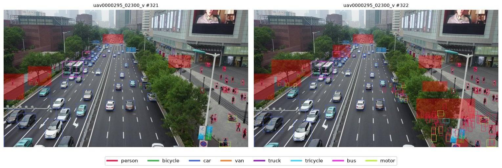

### 1.4 Class distribution

The dataset is unbalanced: car (46% of train), person (30%) and motor (9%) dominate, the other classes have 3–4% each, and bus only 0.9%; it is absent from 32 of the 56 train videos. Val has a different mix: more person (44%), less car (28%) and only 264 buses (0.2%).


### 1.5 Image resolution and object sizes

Resolutions range from 680x382 to 3840x2160. Most train images are medium-sized (53% are 1904x1071), val has more high-resolution ones (34% are 3840x2160), and test has none above 1920x1080 but 16% low-resolution ones (680x382, 960x540) that train and val lack.

Most objects are small (54%) or medium (43%), measured as $\sqrt{w \cdot h}$ at a 1280 px long side with the COCO buckets (small $< 32$ px, large $> 96$ px). Person, bicycle and motor are mostly small, car, van, truck and tricycle mostly medium, and bus medium and large. The median object size per video varies from 18 to 58 px.

| % of boxes | small | medium | large |
|---|---|---|---|
| **all classes** | **54** | **43** | **3** |
| person | 73 | 27 | 0 |
| bicycle | 70 | 30 | 0 |
| car | 42 | 53 | 4 |
| van | 44 | 51 | 5 |
| truck | 26 | 59 | 14 |
| tricycle | 36 | 60 | 4 |
| bus | 13 | 55 | 32 |
| motor | 70 | 29 | 0 |

To choose the input size, I checked the share of objects below 16 px after resizing, since these are very hard to detect. I chose a 1280 px long side (9.8%, against 24% at 960 px) as a middle ground between training/inference time and performance.

| long side, px | 640 | 960 | **1280** | 1920 |
|---|---|---|---|---|
| % of boxes < 16 px | 54.2 | 24.0 | **9.8** | 1.7 |

### 1.6 Anchor sizes and shapes

Anchor-based models (Faster R-CNN, RetinaNet) predict boxes relative to a few predefined anchor sizes and shapes. To find good sizes, I ran k-means ($k = 3, 5, 9$) on the box widths and heights at 1280 px:

| k | mean best IoU | anchors (w x h, px) |
|---|---|---|
| 3 | 0.60 | 15x21, 32x32, 75x58 |
| 5 | 0.66 | 13x18, 19x34, 32x23, 44x41, 92x66 |
| 9 | 0.73 | 11x15, 13x28, 22x19, 20x39, 40x22, 30x31, 39x53, 63x34, 100x72 |

These shapes only show the useful size range, about 13–100 px, far below the 32–512 px default. torchvision takes one anchor size per feature-pyramid level combined with fixed aspect ratios, so the training sizes come from a 1D k-means ($k = 5$, log scale) of $\sqrt{w \cdot h}$: 13/21/31/48/87 px for Faster R-CNN, and 13/26/52/104/208 px for RetinaNet (the smallest size, doubled per level like the stride). The aspect ratios stay at the default $\{0.5, 1, 2\}$, since they cover the box ratios $h/w$:

| percentile | 10th | 50th | 90th |
|---|---|---|---|
| $h/w$ | 0.47 | 1.06 | 2.25 |

### 1.7 Scene density

Most scenes are dense. The mean number of objects per frame varies from 5 to 143 across videos, and the densest frame has 180, so a model must output at least 300 detections (or DETR queries) per image.

| | train | val |
|---|---|---|
| mean objects per frame | 45.7 | 40.1 |
| median | 43 | 37 |
| frames with > 100 objects | 7.6% | 6.4% |

### 1.8 Temporal redundancy

The frame rate is high, so consecutive frames are near-duplicates: they add little to performance but slow down training. I measured the median IoU of the same object $k$ frames apart:

| frame gap $k$ | 1 | 2 | **3** | 5 | 10 |
|---|---|---|---|---|---|
| median IoU of the same object | 0.90 | 0.81 | **0.73** | 0.60 | 0.36 |
| % of objects with IoU > 0.5 | 96 | 86 | **75** | 59 | 39 |

I keep every 3rd frame (8,090 train / 951 val frames), a balance between training time and losing information.

### 1.9 Preprocessing

| step | setting |
|---|---|
| frames | every 3rd frame of each video |
| resize | long side 1280 px, aspect ratio kept |
| normalisation | pixels scaled to [0, 1]; mean/std are applied inside each model |
| training augmentation | horizontal flip ($p = 0.5$), scale jitter 0.75–1.25, colour jitter 0.2 (YOLO and RT-DETR: Ultralytics' built-in augmentation) |
| val / test | resize only |
| targets | 8 classes; ignore regions are not targets and stay in the evaluation ground truth as `iscrowd` |
| reproducibility | seed 42 for python, numpy, torch and the data loaders |

### 1.10 Summary

- **Small objects:** 54% of boxes are under 32 px → 1280 px input, anchors from 13 px, high-resolution feature levels.
- **Dense scenes:** up to 180 objects per frame → at least 300 detections / queries per image.
- **Class imbalance:** car and person are 76% of boxes, bus under 1% → rare-class AP is noisy.
- **Noisy labels:** unlabeled objects and some false boxes cap the achievable mAP.
- **Near-duplicate frames:** every 3rd frame is kept, 3x faster training.
- **Val differs from test:** 4K frames only in val, low-resolution frames only in test → addressed in the final pipeline (section 4).

## 2. Validation protocol

- **Split:** the provided video-level split (56 train / 7 val videos), every 3rd frame, the same for all models.
- **No cross-validation:** K-fold CV would multiply training time by about K, which neither my local GPU (RTX 2050, 4 GB) nor Kaggle's 30 h weekly GPU limit allows. All models use the same split and seed (42), so results are comparable, but differences of a few thousandths of mAP are within noise.
- **Metrics:** COCO mAP@[.5:.95], AP50, AP_small / medium / large and AR (pycocotools), up to 300 detections per image; ignore regions stay in the ground truth as `iscrowd`.
- **Budget:** each required detector is trained from COCO-pretrained weights for about 1–1.5 h on a Kaggle T4, and its experiments keep the same budget. The input is 1280 px, except RT-DETR, which trains at 960 px because a 1280 px input costs 1.6x more per image.

## 3. Detector families

### 3.1 Two-stage: Faster R-CNN

Source: [02_two_stage.ipynb](notebooks/02_two_stage.ipynb)

#### Setup

Faster R-CNN with a ResNet-50 FPN backbone, pretrained on COCO, with a new 8-class head. SGD (momentum 0.9, weight decay 1e-4), lr 0.005 with $\times 0.1$ after epoch 2, 3 epochs, batch 4, 1280 px; the best epoch is kept.

#### Baseline

With the torchvision defaults (anchors 32–512 px, 1000 proposals, NMS IoU 0.5):

| mAP | AP50 | AP_small | AP_large | ms/img (T4) |
|---|---|---|---|---|
| 0.176 | 0.369 | 0.079 | 0.348 | 76 |

#### Experiment 1: RPN proposals × NMS IoU

Both are test-time settings, so no retraining is needed:

- **RPN proposals:** the number of top-scoring candidate regions the Region Proposal Network passes to the second stage (300, 1000, 2000).
- **NMS IoU:** non-maximum suppression keeps the model from giving several boxes for one object. It is applied after the second stage: if two predictions of the same class overlap with IoU above the threshold, only the more confident one is kept (0.4, 0.5, 0.6).

| mAP | NMS 0.4 | NMS 0.5 | NMS 0.6 |
|---|---|---|---|
| 300 proposals | 0.172 | 0.172 | 0.172 |
| 1000 proposals | 0.175 | 0.176 | **0.176** |
| 2000 proposals | 0.175 | 0.174 | 0.171 |

The grid is almost flat: all mAP changes are within 0.005, which is likely noise. The best configuration is 1000 proposals and NMS 0.6.

#### Experiment 2: anchor sizes

The default anchors (32–512 px) are replaced by the k-means sizes 13/21/31/48/87 px, one per FPN level, with the same aspect ratios 0.5, 1, 2 (see [1.6](#16-anchor-sizes-and-shapes)). To check how well they fit, I matched each train box with every anchor shape and kept the best IoU:

| box size | % of boxes | best IoU, default | best IoU, k-means |
|---|---|---|---|
| $< 32$ px | 53.9 | 0.48 | 0.77 |
| 32–96 px | 43.1 | 0.70 | 0.75 |
| 96–150 px | 2.5 | 0.73 | 0.61 |
| $\ge 150$ px | 0.5 | 0.60 | 0.25 |

The fit improves for objects under 96 px (97% of boxes) but worsens for larger ones, which are bigger than the largest anchor. Despite the better fit, mAP decreased by 0.027. Two likely reasons:

- **Large objects lost their anchors:** AP_large fell from 0.348 to 0.277, while AP_small did not change.
- **Pretraining was lost:** the COCO-pretrained RPN head was trained for the default sizes, and 3 epochs were not enough to adapt it to the new anchors.

#### Final model

Default anchors, 1000 proposals and NMS 0.6:

| model | mAP | AP50 | AP_small | AP_medium | AP_large | ms/img (T4) |
|---|---|---|---|---|---|---|
| baseline (NMS 0.5) | 0.176 | 0.369 | 0.079 | 0.166 | 0.348 | 76 |
| **final (NMS 0.6)** | **0.176** | **0.366** | **0.079** | **0.166** | **0.347** | **76** |
| k-means anchors | 0.149 | 0.334 | 0.081 | 0.152 | 0.277 | 76 |

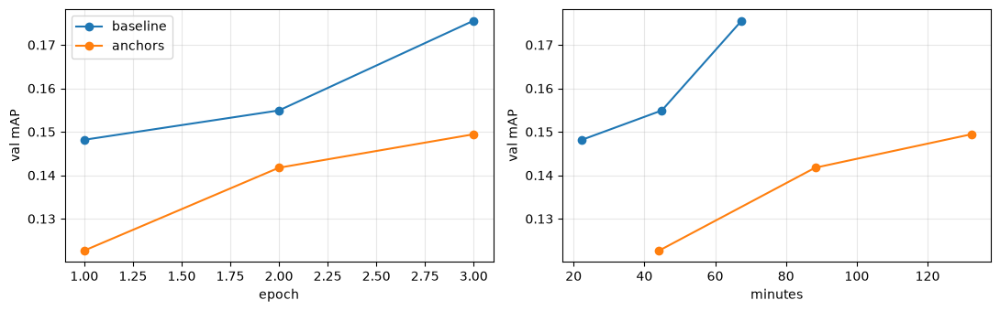

The model had not converged: val mAP was still rising at epoch 3, so a longer schedule is the most likely gain.

#### What each stage contributes

- **RPN (first stage):** class-agnostic detection of objects. It scores anchors as object or background, roughly corrects their boxes and keeps the best candidates. Its recall is an upper bound for the whole model, since an object without a proposal cannot be detected.
- **RoI head (second stage):** pools features for each proposal, classifies it into the 8 classes or background, refines the box a second time and removes duplicates with NMS. It turns 1000 proposals into about 59 confident boxes per image.

| recall ($\text{IoU} \ge 0.5$) | small | medium | large |
|---|---|---|---|
| RPN, top 1000 proposals | 0.71 | 0.82 | 0.99 |
| final detections ($\text{score} \ge 0.3$) | 0.53 | 0.67 | 0.95 |

Small objects are limited by both stages: the RPN misses 29% of them, and the second stage loses another 18 points. More proposals do not help, since 2000 proposals give the same recall as 1000.

#### Failure cases

At $\text{score} \ge 0.3$ and $\text{IoU} \ge 0.5$:

1. **Small and occluded objects are missed.** Only 46% of small objects are detected correctly (24% missed, 23% mislocalized), against 81% of large ones, and 61% of heavily occluded objects are missed. Small objects have few pixels and weak features, and occluded ones look like background.
2. **Similar classes are confused.** Of the detected bicycles, 45% are classified as motors, possibly because motors are far more frequent in the dataset. Of the detected buses, 71% are classified as cars, a direct consequence of the imbalance and the very low number of buses.
3. **Missing labels and background false positives.** A third of the detections are on background; part of them are real objects without a label.

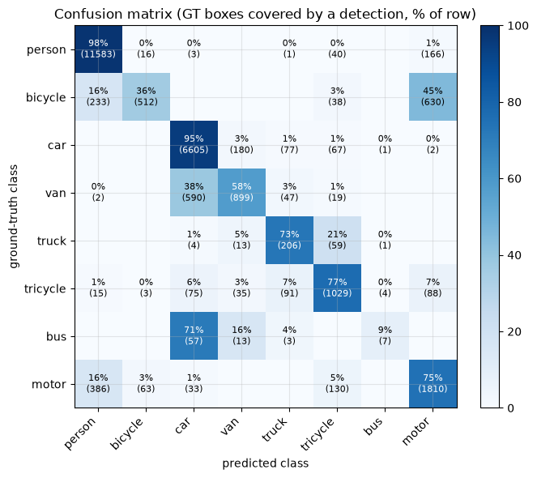

Example frames, ground truth on top and predictions below:

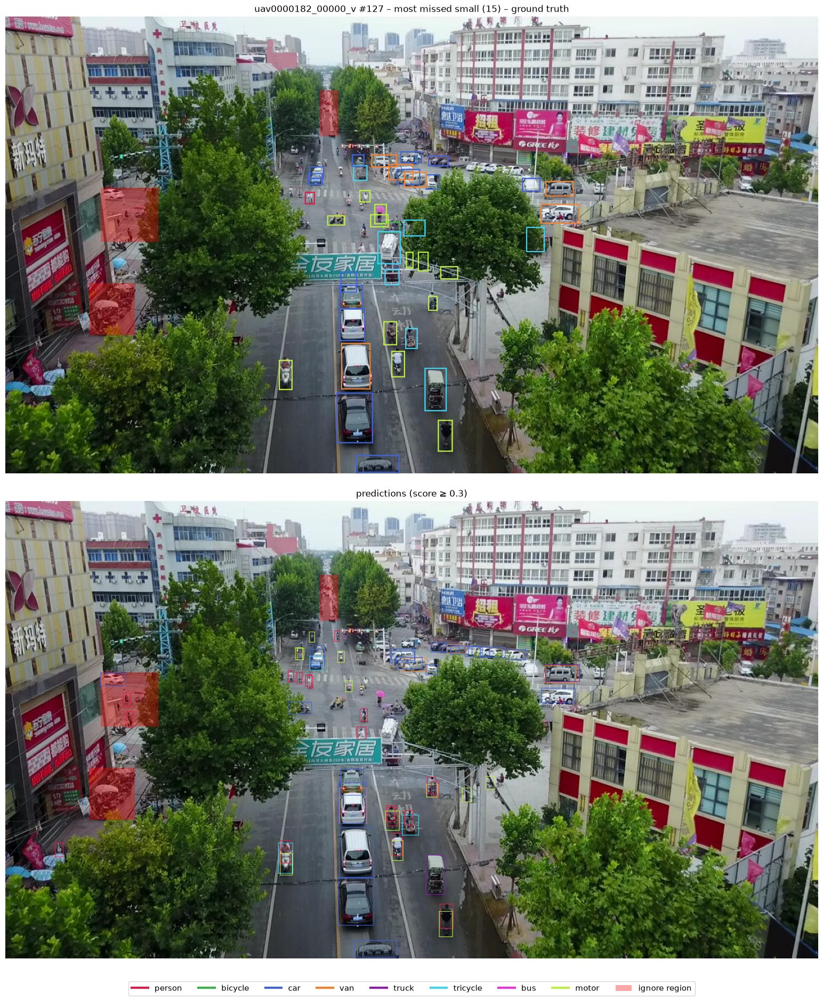

*The frame from [1.3](#13-label-quality): not all parked cars are labeled, and the model detects them correctly, but its score is lowered because the GT does not have them. Some small objects are also misclassified or missed.*

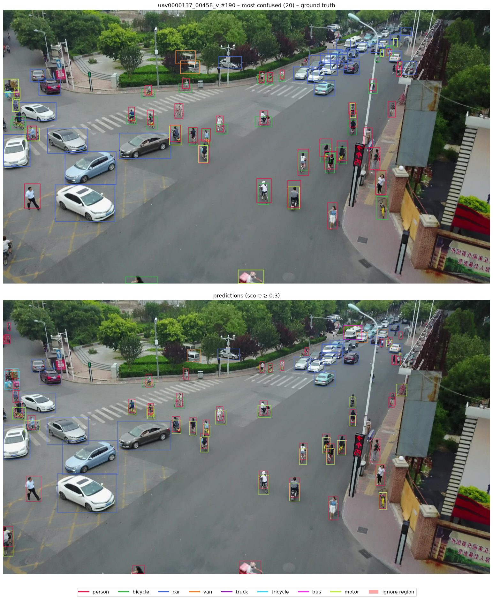

*Many bicycles are classified as motors.*

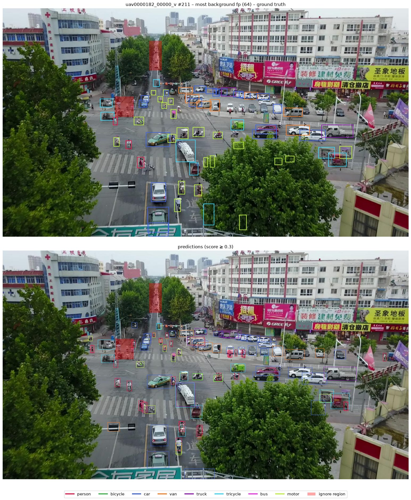

*The same issues as in the first frame; in addition, a traffic light is classified as a van, and some other objects are misclassified or missed.*

### 3.2 One-stage anchor-based: RetinaNet

Source: [03_one_stage_anchor.ipynb](notebooks/03_one_stage_anchor.ipynb)

#### Setup

RetinaNet ResNet-50 FPN v2, pretrained on COCO, new 8-class layer. Levels P3–P7 (strides 8–128), 9 anchors per location, focal loss ($\alpha = 0.25$, $\gamma = 2$), GIoU box loss. SGD, lr 0.0025 with $\times 0.1$ after epoch 2, 3 epochs, batch 4, 1280 px. The baseline uses the torchvision defaults: anchor base sizes 32–512 px, IoU thresholds 0.5/0.4, NMS 0.5.

#### Experiment 1: anchor sizes

The base sizes start from the smallest k-means size (13 px, [1.6](#16-anchor-sizes-and-shapes)) and double up to 208 px; each level multiplies its base by $(1, 2^{1/3}, 2^{2/3})$, so the levels cover 13–330 px without gaps. Doubling follows the stride, keeping the same anchor/stride ratio on every level, which the shared head needs.

| box size | % of boxes | best IoU, default | best IoU, data |
|---|---|---|---|
| $< 32$ px | 53.9 | 0.48 | 0.83 |
| $\ge 32$ px | 46.1 | 0.83 | 0.82 |

The fit improves strongly for small objects, but mAP decreased by 0.042:

- **Fewer positives:** at $1.6\times$ the stride (default $4\times$) anchors overlap less, so an image gets 189 positives instead of 628.
- **Pretraining lost:** the COCO head was trained for anchors $4\times$ the stride, and 3 epochs were not enough to adapt it.

#### Experiment 2: IoU thresholds

An anchor is positive if its IoU with a GT box is $\ge$ the foreground threshold and background if it is below the background threshold. Small boxes rarely reach IoU 0.5, so lowering the thresholds from 0.5/0.4 to 0.4/0.3 gives them more positives (1,695 instead of 628 per image). mAP still decreased by 0.024, and even AP_small fell (0.058 → 0.048): the extra positives are loose boxes, so the model learns to score poorly placed boxes highly.

NMS 0.6 at test time gave no gain over 0.5 (mAP 0.145 vs 0.146).

#### Final model and comparison with Faster R-CNN

No experiment beat the baseline, so it is the final model.

| model | mAP | AP50 | AP_small | AP_medium | AP_large | ms/img (T4) |
|---|---|---|---|---|---|---|
| Faster R-CNN, tuned | 0.176 | 0.366 | 0.079 | 0.166 | 0.347 | 76 |
| **RetinaNet, baseline = final** | **0.146** | **0.289** | **0.058** | **0.135** | **0.289** | **57** |
| data anchors | 0.104 | 0.246 | 0.046 | 0.095 | 0.227 | 56 |
| IoU 0.4/0.3 | 0.122 | 0.243 | 0.048 | 0.108 | 0.248 | 57 |

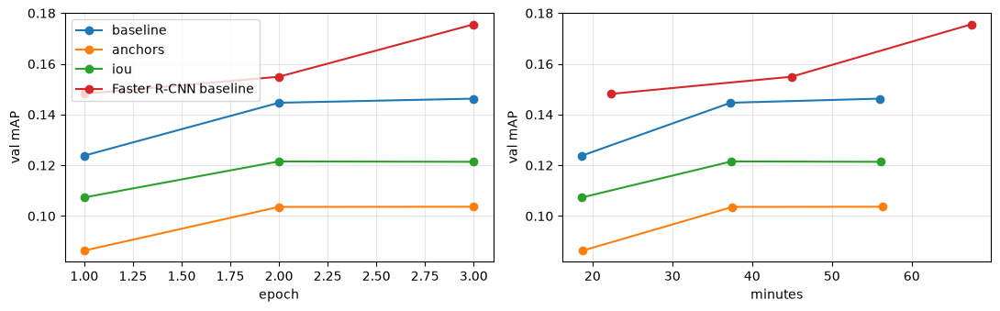

RetinaNet is 0.030 mAP below Faster R-CNN but 25% faster. It matches it on person (AP 0.220 vs 0.219) and loses most on rare large vehicles (bus 0.020 vs 0.088, truck 0.116 vs 0.193). It plateaued after the learning-rate drop, while Faster R-CNN was still improving.

#### What removing the proposal stage costs

- **Foreground/background imbalance:** about 170k anchors per frame against about 46 objects, so easy background dominates the loss. Addressed by focal loss (down-weights easy anchors) and the prior bias init; Faster R-CNN instead samples 512 RoIs with up to 25% positives.
- **Only one refinement:** class and box are predicted once from a fixed grid location. Addressed by IoU-based losses, quality-aware scores (centerness, GFL) or cascade refinement.
- **Small objects depend only on the anchor assignment**, with no stride-4 level and no second chance:

| covered ($\text{IoU} \ge 0.5$, $\text{score} \ge 0.3$) | small | medium | large |
|---|---|---|---|
| Faster R-CNN | 0.53 | 0.67 | 0.95 |
| RetinaNet | 0.33 | 0.56 | 0.89 |

- **Faster inference:** no per-proposal computation (57 vs 76 ms/img).

#### Failure cases

At $\text{score} \ge 0.3$ and $\text{IoU} \ge 0.5$:

1. **Small and occluded objects are missed:** 28% of small objects are correct (48% missed; Faster R-CNN 46% correct), and 70% of heavily occluded ones are missed.
2. **Similar classes are confused**, as in 3.1: 48% of detected bicycles become motors and 35% persons, all 49 detected buses become cars, and 58% of vans become cars.
3. **Background false positives:** 20% of detections. Duplicates are rare (1.5%, Faster R-CNN 4.6%), since each location is predicted once.

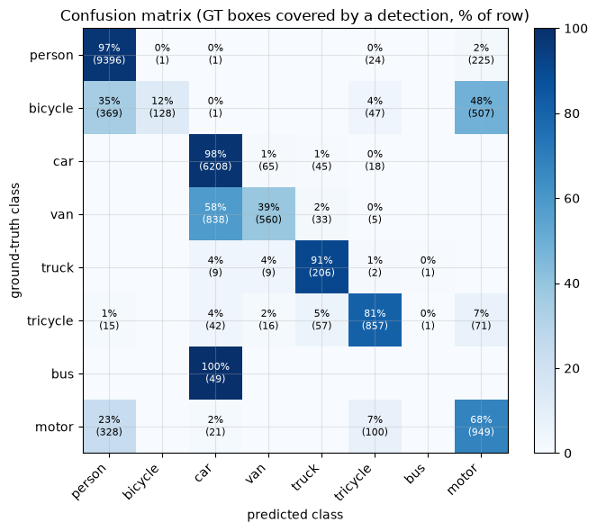

Example frames, ground truth on top and predictions below:

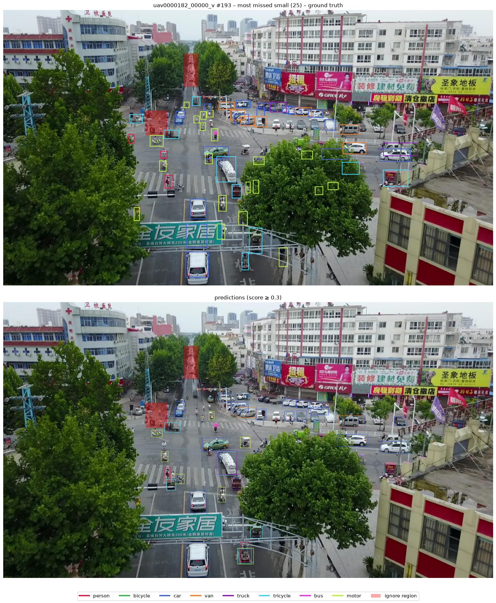

*Many small objects are missed.*

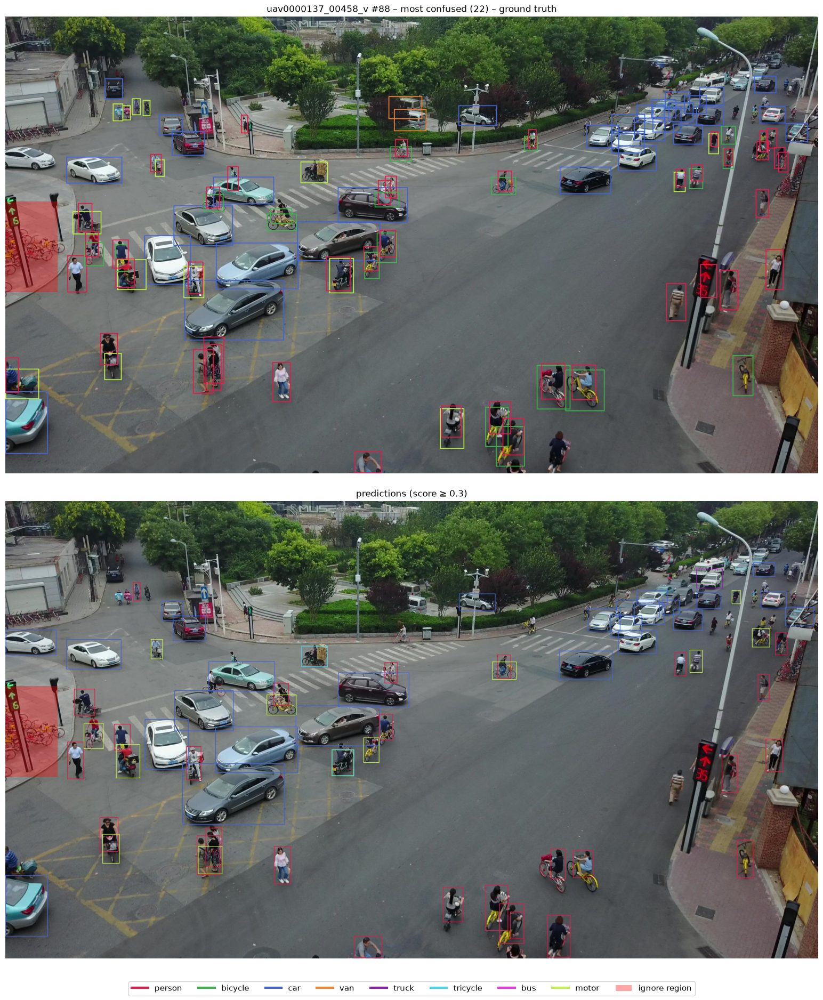

*Almost all bicycles are missed; only the persons riding them are detected.*

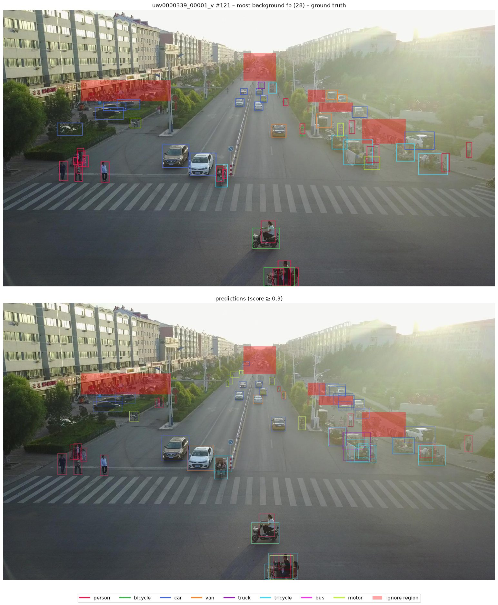

*Many boxes on the background, and some objects covered by several boxes.*

### 3.3 One-stage anchor-free: YOLO11

Source: [04_one_stage_anchor_free.ipynb](notebooks/04_one_stage_anchor_free.ipynb)

#### Setup

YOLO11s, pretrained on COCO, new 8-class head; DFL + CIoU box loss, BCE classification. AdamW, lr 0.001, nominal batch 64, Ultralytics augmentation (mosaic off for the last 2 epochs), 1280 px. The 1.1 h budget fits 9 epochs (Faster R-CNN: 3). Baseline: levels P3–P5, CIoU, NMS 0.7.

#### How locations are assigned without anchors

Each feature-map cell is a point that predicts the distances to the 4 box sides and 8 class scores. During training, the task-aligned assigner (TAL) takes the points inside a GT box as candidates and makes the top 10 by $t = \text{score}^{0.5} \cdot \text{CIoU}^{6}$ positives, so positives follow the current predictions instead of fixed anchor shapes. Measured on train frames:

| GT box size | candidate points | on the object |
|---|---|---|
| tiny ($< 16$ px), P3–P5 | 5.8 | 59% |
| small (16–32 px), P3–P5 | 12.4 | 97% |
| tiny ($< 16$ px), P2–P5 | 14.2 | 97% |

Tiny boxes have fewer candidates than the top 10, so all of them become positives, including those off the object, and in dense scenes neighbours compete for the same points (10% of tiny boxes share all of them).

#### Experiment 1: P2 level

Previous models struggled with small objects, so I added a P2 level (stride 4) to the default P3–P5 (strides 8, 16, 32). Its feature map (320×180 for a 1280×720 frame) preserves more detail and gives tiny boxes 2.4× more candidates (table above), but increases training time.

P2 improved AP_small (+0.014) and AR (+0.029), but mAP decreased by 0.007. Within the same time budget it reached only 5 epochs (baseline 9), and at epoch 5 both were level, so it may outperform the baseline with more epochs.

#### Experiment 2: NWD loss

IoU-based losses are very sensitive to small shifts of small objects. Normalized Wasserstein Distance models each box as a 2D Gaussian: $\text{NWD} = \exp(-W_2 / C)$ depends on the absolute pixel offset, not the box size, and stays informative without overlap. With $C = 32$ px (the median box size), the box loss becomes $0.5\,(1 - \text{CIoU}) + 0.5\,(1 - \text{NWD})$.

It decreased mAP by 0.011, and its val mAP peaked at epoch 5 and then fell. A likely cause: with $C = 32$, a 2 px shift gives NWD 0.92 at any box size, so half of the loss barely pushes for exact localization.

#### Final model and comparison

The best model (baseline) was tuned at test time over the input size (1280, 1536, 1920 px) and NMS IoU (0.6, 0.7). NMS changed mAP by at most 0.001. Higher resolution trades large objects for small ones: 1536 px raised AP_small (0.102 → 0.110) at equal mAP, and 1920 px lost large objects (AP_large 0.334 → 0.287), since the model was trained at 1280 px. **Selected: 1280 px, NMS 0.6.**

| model | mAP | AP50 | AP_small | AP_medium | AP_large | ms/img (T4) | public | private |
|---|---|---|---|---|---|---|---|---|
| Faster R-CNN, tuned | 0.176 | 0.366 | 0.079 | 0.166 | **0.347** | 76 | – | – |
| RetinaNet, tuned | 0.146 | 0.289 | 0.058 | 0.135 | 0.289 | 57 | – | – |
| YOLO11s baseline | 0.206 | 0.393 | 0.102 | 0.193 | 0.334 | 40 | – | – |
| P2 level | 0.199 | 0.386 | **0.116** | 0.179 | 0.366 | 41 | – | – |
| NWD loss | 0.195 | 0.384 | 0.104 | **0.194** | 0.308 | 41 | – | – |
| **YOLO11s final** | **0.207** | **0.398** | 0.102 | **0.194** | 0.334 | 41 | 0.2145 | 0.1757 |

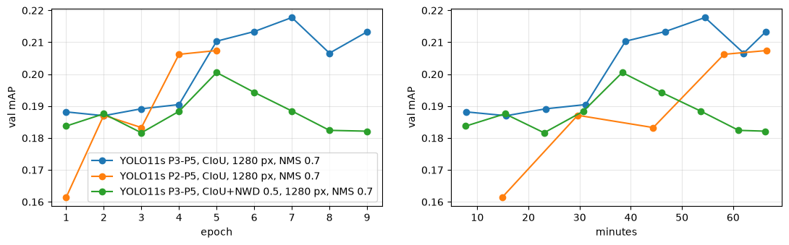

The curves show Ultralytics' own val mAP, which is not comparable with 3.1–3.2.

YOLO11s is the best and fastest model so far, ahead on small and medium objects; Faster R-CNN stays slightly ahead on large ones. Faster R-CNN still finds more objects (AR 0.401 vs 0.307), so YOLO wins by better localization (AP75 0.186 vs 0.151), not recall. Part of the gap may come from 9 vs 3 epochs.

#### Failure cases

At $\text{score} \ge 0.3$ and $\text{IoU} \ge 0.5$:

1. **Small objects are missed:** 35% correct (45% missed), between Faster R-CNN (46%) and RetinaNet (28%).
2. **Similar classes are confused:** van → car (54% of detected vans), bicycle → motor (41%), bus → car (55 of 69).
3. **Background false positives:** 16% of detections; duplicates are almost absent (0.4%).

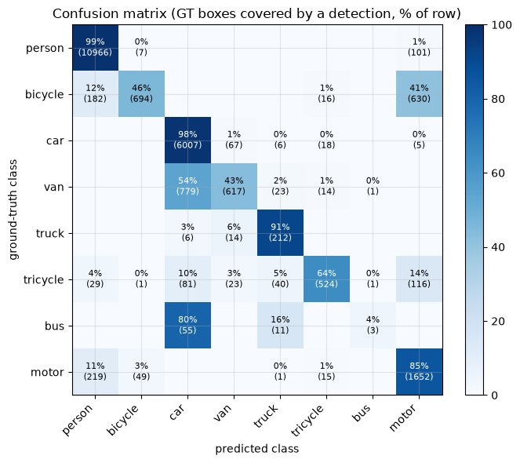

Example frames, ground truth on top and predictions below:


*Many small and distant objects are missed; some GT boxes lie on foliage with no visible object (as in [1.3](#13-label-quality)).*

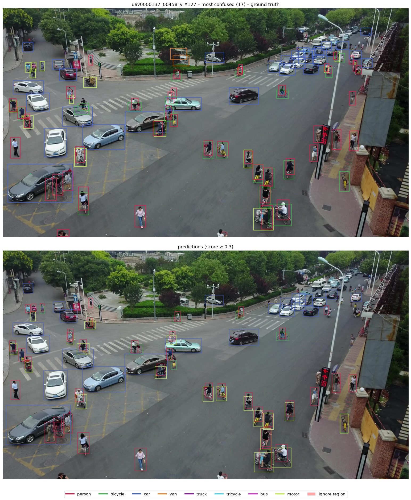

*Distant cars are missed, and bicycles are classified as motors.*

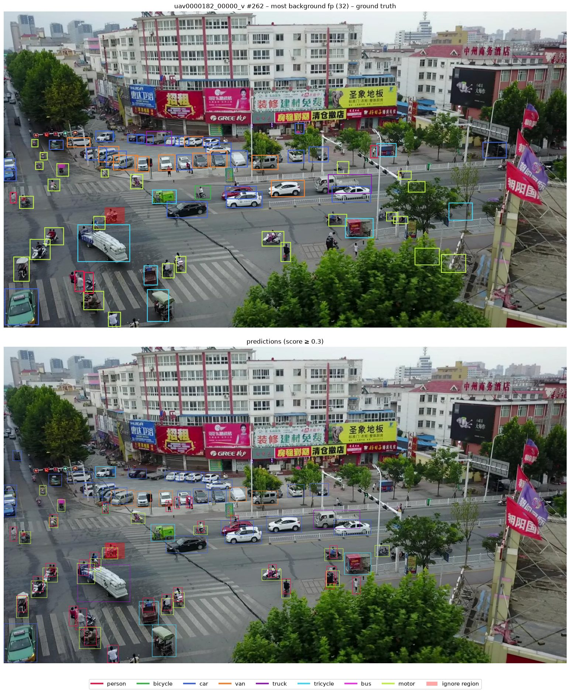

*The model performs well, but the GT is poor: most riders on motors are not labeled as persons, while the model detects them, and some GT boxes are on the background.*

### 3.4 Query-based: RT-DETR

> - Experiments: separate backbone/transformer LR (`rtdetr_lr`), denoising queries count (`rtdetr_nd200/400`), tuned (`rtdetr_final`).
> - Bipartite matching removes NMS — 2 sentences, and how it changes training (slower convergence, one-to-one targets).
> - Plot: val mAP over epochs vs. a CNN detector under the same budget. State whether it converged.
> - Small objects and dense scenes vs. YOLO.

### 3.5 Comparison of all models

> - One summary table: every tuned model (+ baselines in gray or separate rows): mAP, AP50, AP_s, AP_m, AP_l, FPS, public LB.
> - 3–4 sentences: which family wins on this data and why (small objects, density), the speed/accuracy trade-off, and which models go into the final pipeline.

## 4. Final pipeline

> **Contains:** must clearly separate "data/inference changes" from "model changes" (graded separately). Keep the same validation as above.

### 4.1 Data and inference strategy

> Source: `notebooks/final_pipeline/01_data_tests.ipynb`.
> - Table: reference vs. masked ignore regions (`s1_ignore`), low-resolution simulation (`s1_lowres`), less mosaic (`s1_mosaic`), tile-based training (`s1_tile`) — val mAP and public LB.
> - Which changes helped, which did not, and a likely reason for each.

### 4.2 Model changes

> Source: `notebooks/final_pipeline/02_long_runs.ipynb`.
> - Long runs at 960 and 1280 (`s2_960`, `s2_1280`): gain from more epochs / higher resolution compared to the budget-limited runs in section 3.
> - Effect of model change kept separate from the data change in 4.1.

### 4.3 Ensembles and final selection

> Source: `notebooks/final_pipeline/03_final_models.ipynb`.
> - WBF ensemble options (1280 + 960 + YOLO11s + tile) — table with val mAP and public LB.
> - Retraining on train + val: why it is allowed now (hyperparameters already fixed) and what changed.
> - The two submissions selected for the private LB and why (internal val, not only public LB).

### 4.4 Unsuccessful attempts

> Short list of what did not work, with the numbers: e.g. NWD loss, low-resolution simulation, specific ensemble members, any bugs found (WBF fix). One line each: what, result, likely why.

## 5. Conclusions

> 3–5 bullets: main lessons (resolution and small objects matter most, which family fits VisDrone best, what data/inference strategy gave the largest gain, what you would try next with more compute — e.g. temporal post-processing, SAHI).

## 6. Final model and run instructions

> **Contains:** name the exact final model/ensemble and the submission file. Then how to reproduce. Draft from the template version below — update notebook names and add the final-pipeline steps.

**Final model.** _TODO: ensemble name, members, input sizes, WBF parameters, submission file in `submissions/`._

**Code layout.** Shared code is in `utils/common.py` and `utils/ultra.py`; each step has its own notebook: `notebooks/01_data_analysis` … `05_query_based` for the required detectors and `notebooks/final_pipeline/01_data_tests`, `02_long_runs`, `03_final_models` for the final pipeline. Trained runs (metrics, predictions, checkpoints) are stored in the Hugging Face model repo `BohdanZasymovych/ai-hw2-object-detection` under `runs/<name>/`. All randomness is seeded with `SEED = 42`.

**Local setup.**

```bash
python -m venv .venv
.venv/bin/pip install -r requirements.txt
```

The competition data is downloaded on the first run of `01_data_analysis` (Kaggle API token in `~/.kaggle/kaggle.json`). Tested with Python 3.14.4, torch 2.15.0, torchvision 0.29.2; minimum versions are in `requirements.txt` and are checked on import.

**Kaggle.** Create a notebook, attach the competition data, enable a GPU and Internet, and add the secret `HF_TOKEN` (Hugging Face write token). The first cell of each notebook clones this repository and installs only the missing packages; Kaggle's preinstalled torch/torchvision are used. Set `RUN` to the stages to train in that session; finished stages are uploaded to the Hugging Face repo.

**Reproducing the results without training.** Run a notebook locally with `RUN = set()`: all stages are downloaded from the Hugging Face repo and the tables, plots and failure cases are rebuilt from the saved metrics and predictions.

> _TODO: add the exact sequence to regenerate the submitted CSV (which notebook, which `RUN` stages, expected runtime on Kaggle T4)._

## References

> Every paper/library you took ideas or code from (assignment requires citing): VisDrone, Faster R-CNN, FPN, RetinaNet, YOLO11/Ultralytics, TOOD, NWD, RT-DETR, DN-DETR, WBF, pycocotools/faster-coco-eval, SAHI if used.
